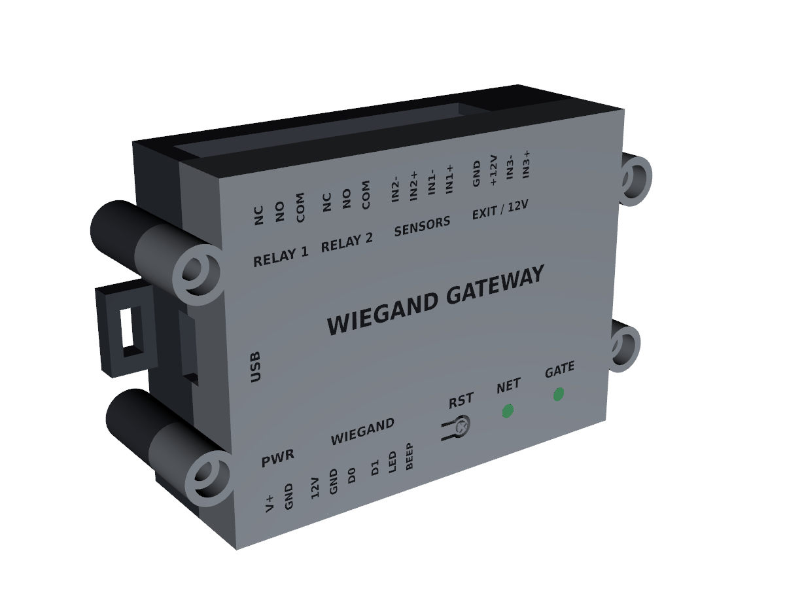
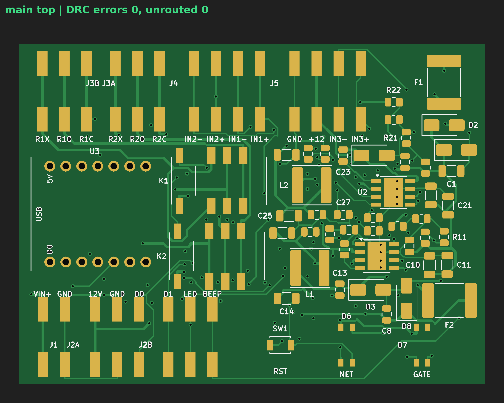
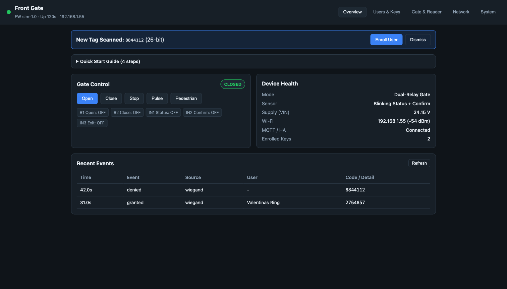
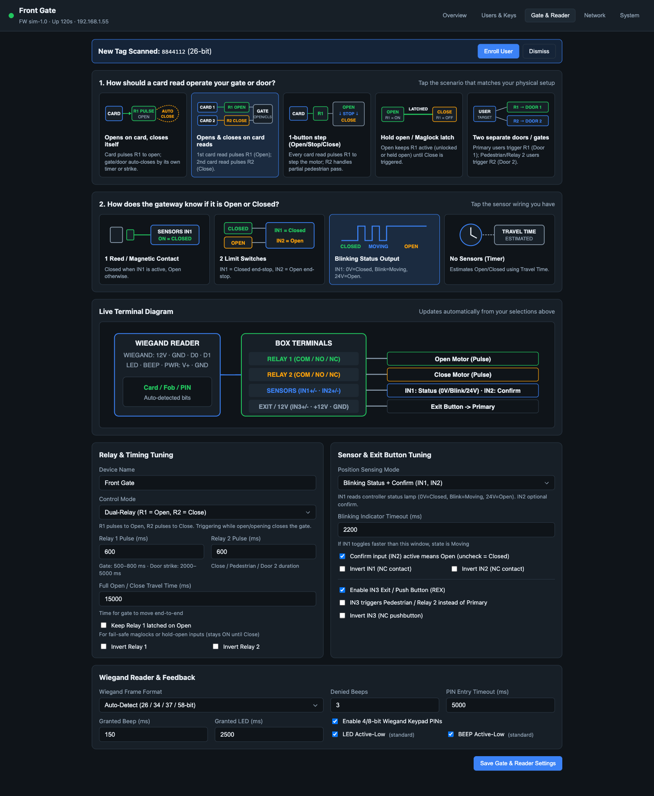
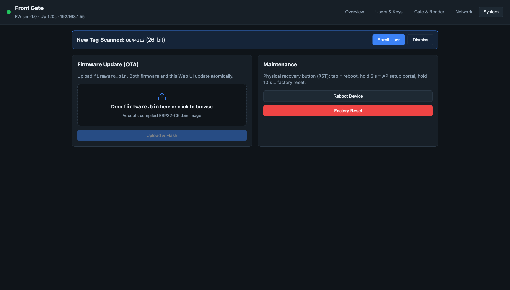

# Wiegand Gate Controller (`wiegand-gate-controller`)

Compact **ESP32-C6** Wiegand access-control gateway for sliding/swing gates and doors — connects standard 12 V Wiegand card/UHF/keypad readers to gate controllers, door strikes, maglocks, and **Home Assistant** over Wi-Fi/MQTT.

## Enclosure & Hardware (`v1`)



*3D-printed enclosure (`78.8 × 58.8 × 27.7 mm`) with engraved terminal labels and translucent `0.4 mm` status LED windows.*



*4-layer PCB (`74.0 × 54.0 mm`) with tool-free WAGO 2086 SMD push-in terminals and socketed Seeed XIAO ESP32-C6.*

- **9–32 V DC input (`PWR`)**: polyfuse, reverse-polarity diode, TVS clamp, ADC supply monitor, and dual step-down converters (`+5 V` logic + fused `+12 V` reader/aux supply).
- **Wiegand reader port (`WIEGAND`)**: 5 V-tolerant Schmitt-buffered `D0`/`D1`, open-drain `LED`/`BEEP` outputs, supports auto-detected 26/34/37/58-bit cards and 4/8-bit keypad PINs.
- **2× isolated relays (`RELAY 1`, `RELAY 2`)**: potential-free Form-C dry contacts (`2 A / 30 V DC` max) for Open/Close, Step/Pedestrian, or Dual-Door control.
- **3× opto-isolated inputs (`SENSORS`, `EXIT / 12V`)**: accept 5–24 V DC signals or dry contacts (magnetic reed, dual limits, controller blinking status output, and exit/REX pushbutton).
- **Tool-free WAGO 2086 SMD push-in terminals** (`J1`–`J5`, 3.5 mm pitch) + **Seeed XIAO ESP32-C6** with external U.FL antenna, dual `WS2812B` RGB LEDs (`NET`, `GATE`), and `RST` button behind a `0.4 mm` translucent cover window.

## Web UI & Home Assistant

### Overview & Live I/O


### Visual Gate Setup & Terminal Map


### Firmware OTA & Maintenance


- **Standalone local access control**: stores up to 500 users/cards/PINs on flash with one-click enrollment of the last unknown scanned tag.
- **Visual setup**: tap how a card read operates your gate/door and how open/closed position is sensed; the live terminal diagram updates to match the labels engraved on the box.
- **Separated Network & OTA pages**: dedicated Wi-Fi + MQTT / Home Assistant auto-discovery tab (`cover` / `lock`, `binary_sensor`, `sensor`, `button`) and drag-and-drop `firmware.bin` OTA updates (gzip-embedded Web UI updates atomically with firmware).

## Enclosure Terminal Map

| Edge | Box Group | Pins | Function |
| :--- | :--- | :--- | :--- |
| Bottom | `PWR` | `V+`, `GND` | 9–32 V DC input |
| Bottom | `WIEGAND` | `12V`, `GND`, `D0`, `D1`, `LED`, `BEEP` | 12 V Wiegand reader & keypad |
| Top | `RELAY 1` | `NC`, `NO`, `COM` | Primary relay dry contact |
| Top | `RELAY 2` | `NC`, `NO`, `COM` | Secondary / Close / Pedestrian relay |
| Top | `SENSORS` | `IN2-`, `IN2+`, `IN1-`, `IN1+` | Position / limit / status inputs |
| Top | `EXIT / 12V` | `GND`, `+12V`, `IN3-`, `IN3+` | Exit (REX) input & +12 V wetting supply |
| Left | `USB` | USB-C | Initial flashing & serial console |

## Documentation

- [Wiring & Controller Integration Guide](docs/wiring.md)
- [PCB, BOM & 3D Enclosure Ordering Guide](docs/ordering.md)

## Quick Build & Verification (Docker-first)

```bash
# Python lint
docker compose --profile lint run --rm -T lint check .

# Firmware native & sanitized unit tests + ESP32-C6 release image
docker compose --profile lint run --rm -T cpp-lint "pio test -d firmware -e native && pio test -d firmware -e native_sanitized"
python3 firmware/scripts/release_firmware.py

# Hardware PCB DRC/connectivity + JLCPCB release + tests
docker compose --profile hardware run --rm -T -e JLC_LIVE=0 eda "python3 hardware/scripts/release.py v1 && python3 -m pytest hardware/tests -q -p no:cacheprovider"

# Mechanical enclosure build + tests
docker compose --profile hardware run --rm -T cad "python3 hardware/scripts/build.py --in-cad --test"
```

## License

See [LICENSE.md](LICENSE.md).
